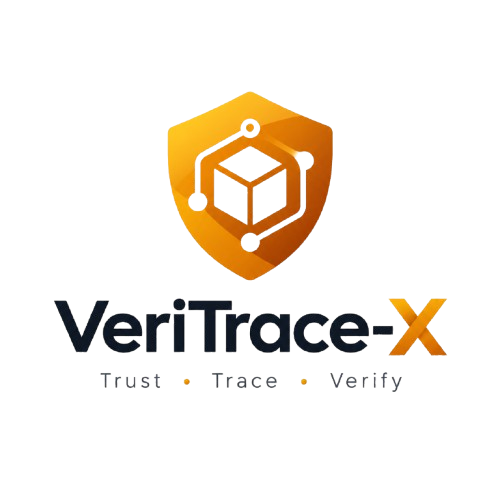

<div align="center">
  
  <h3>Trust Every Transaction. Explain Every Risk.</h3>
  <p>An Explainable-AI framework for blockchain-based fraud detection in supply-chain traceability.</p>
</div>

---

> **Research context, not a production claim.** VeriTrace-X is built around the research concept
> *"An Explainable AI Framework for Blockchain-Based Fraud Detection in Supply Chain Traceability."*
> The DataCo Smart Supply Chain dataset (~180,519 order-line records, ~2.25% suspected-fraud rate) is used
> as **research context**. The system carefully distinguishes **suspected fraud**, **model predictions**, and
> **human-confirmed fraud**, and never represents an uncalibrated model probability as a confirmed probability of fraud.

## What it does

| Capability | Description |
|---|---|
| **Fraud detection** | ML risk scoring of supply-chain transactions (Logistic Regression / Random Forest / XGBoost, selected on measured validation metrics). |
| **Explainable AI** | Plain-English explanations backed by SHAP (and optional LIME) feature contributions. |
| **Blockchain traceability** | Tamper-evident audit trail. Dev mode uses a local hash-chain (clearly labelled *not on-chain*); production targets Hyperledger Fabric. |
| **Human review** | Case workflow with role-based decisions, notes, escalation, and preserved history — a model prediction never auto-confirms fraud. |

## Tech stack

**Frontend** — React + Vite · Tailwind CSS · lightweight shadcn-style primitives · Lucide icons · Motion · GSAP · Recharts · React Router · React Hook Form + Zod
**Backend** — FastAPI · Pydantic · SQLAlchemy + Alembic · Pandas/NumPy · scikit-learn + XGBoost · SHAP + LIME
**Data** — PostgreSQL (prod) / SQLite (zero-setup dev)
**Blockchain** — Hyperledger Fabric (prod) / local hash-chain (dev)

## Repository layout

```
frontend/   React + Vite SPA (design system, pages, features)
backend/    FastAPI app (api, core, models, schemas, services, ml, blockchain, workers)
ml/         Reproducible training & evaluation pipeline + artifacts
blockchain/ Fabric network, chaincode, scripts
docs/       architecture · setup · api · model-evaluation · deployment · security
```

## Quick start (local dev)

```bash
# 1. Frontend
cd frontend
npm install
npm run dev          # http://localhost:5173

# 2. Backend  (separate terminal — added in Phase 2)
cd backend
python -m venv .venv && . .venv/Scripts/activate   # Windows
pip install -r requirements.txt
uvicorn app.main:app --reload                       # http://localhost:8000
```

See [`docs/setup.md`](docs/setup.md) for full setup, [`docs/model-evaluation.md`](docs/model-evaluation.md) for the ML
methodology, and [`docs/deployment.md`](docs/deployment.md) for free-tier deployment.

## Build status

This project is built in phases. See the progress notes at the top of each phase in the docs.

- [x] **Phase 1** — Scaffold, Clean Amber design system, navigation, reusable components, landing page.
- [ ] **Phase 2** — Backend, auth, dataset upload/validation.
- [ ] **Phase 3** — ML training/evaluation, prediction API, SHAP/LIME.
- [ ] **Phase 4** — Dashboard, transactions, details, human review.
- [ ] **Phase 5** — Traceability + Hyperledger Fabric integration.
- [ ] **Phase 6** — Reports, security hardening, automated tests.
- [ ] **Phase 7** — Deployment, docs, public demo.

## License

MIT (code). Dataset and any third-party assets retain their original licenses — verify before redistribution.
